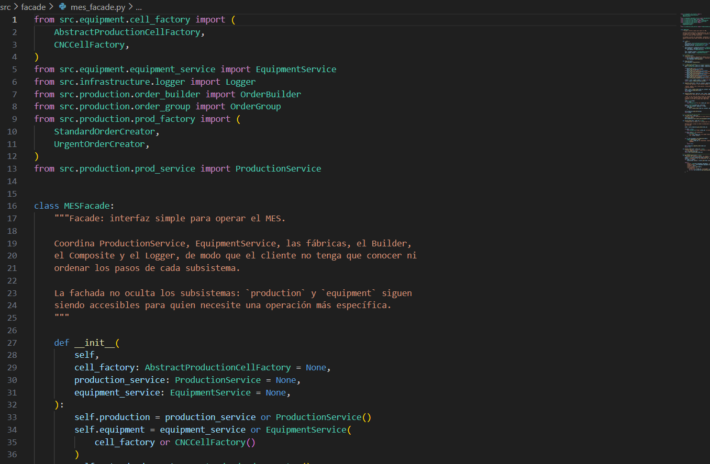
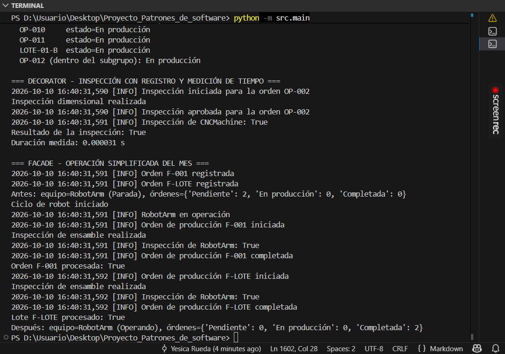
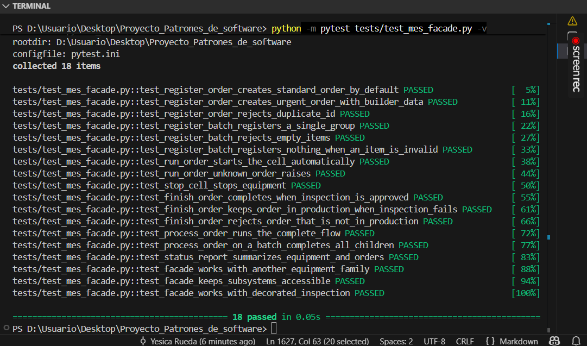
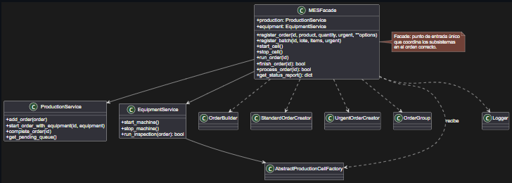
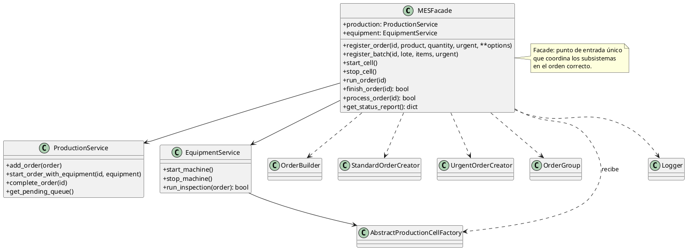

# Aplicación del patrón Facade

## Objetivo

Ofrecer una interfaz única y simple para operar el MES (registrar órdenes y lotes, ponerlos en producción, inspeccionarlos, completarlos y consultar el estado), de modo que quien use el sistema no tenga que conocer los distintos subsistemas ni el orden correcto en que se deben llamar.

---

## Contextualización y problema identificado

Después de implementar los patrones anteriores, el MES quedó compuesto por varios subsistemas que colaboran entre sí:

* `ProductionService`: registra, inicia y completa órdenes.
* `EquipmentService`: controla el equipo y ejecuta inspecciones.
* Abstract Factory (`CNCCellFactory`, `RobotCellFactory`): crean el equipo y su inspección.
* `OrderBuilder` y los creadores del Factory Method: construyen y crean las órdenes.
* `OrderGroup` (Composite): representa lotes.
* `Logger` (Singleton + Adapter): registra los eventos.

Para ejecutar un caso tan simple como "registrar una orden urgente, producirla e inspeccionarla", el código cliente (`main.py`) debe conocer todos esos subsistemas y encadenar los pasos en el orden correcto:

```python
production = ProductionService()
equipment = EquipmentService(RobotCellFactory())
equipment.start_machine()

data = OrderBuilder("F-001", "Ensamble A", 10).with_lote("L-2026-10").build()
order = UrgentOrderCreator().create_order(data)
production.add_order(order)

production.start_order_with_equipment("F-001", equipment)
if equipment.run_inspection(order):
    production.complete_order("F-001")
```

Este flujo presenta varios problemas:

* El cliente depende de cinco clases de subsistemas distintos.
* El orden de los pasos es una regla del negocio (el equipo debe estar operando antes de iniciar; la inspección va antes de completar) que cada cliente tendría que recordar y repetir.
* Cualquier cambio interno de un subsistema afecta a todos los clientes que lo usan directamente.

## Necesidad

* Un punto de entrada único para las operaciones habituales del MES.
* Que el orden del flujo (iniciar equipo → iniciar orden → inspeccionar → completar) quede definido en un solo lugar.
* Reducir el acoplamiento entre el cliente y los subsistemas.
* No impedir el acceso directo a los subsistemas cuando se necesite una operación más específica.

## Alternativas consideradas

| Alternativa | Por qué se descartó |
| ----------- | ------------------- |
| Dejar el flujo en `main.py` | Cada cliente nuevo repetiría los pasos y las reglas de orden. |
| Ampliar `ProductionService` con el flujo completo | Ya conoce a `EquipmentService` solo a través de `start_order_with_equipment`; agregarle inspección, creación de órdenes y lotes lo acoplaría a casi todo el sistema y mezclaría responsabilidades. |
| Mediator entre `ProductionService` y `EquipmentService` | Los subsistemas no necesitan comunicarse entre sí de forma compleja; el problema es la complejidad que ve el cliente, no la comunicación interna. |
| **Facade: una clase que coordina los subsistemas y expone operaciones de alto nivel** | Simplifica el uso sin modificar los subsistemas. **Seleccionada.** |

---

## Patrón aplicado

Facade proporciona una interfaz unificada y simplificada a un conjunto de interfaces de un subsistema, y define una capa de más alto nivel que facilita su uso.

### Interpretación dentro del MES

* **Facade:** `MESFacade`.
* **Subsistemas:** `ProductionService`, `EquipmentService`, las fábricas de equipos, `OrderBuilder` con los creadores de órdenes, `OrderGroup` y `Logger`.
* **Cliente:** `main.py`, y cualquier código futuro (por ejemplo, una interfaz de usuario).

---

## Implementación

El patrón se implementó en un archivo nuevo:

`src/facade/mes_facade.py`

Los subsistemas existentes **no se modificaron**.



| Operación de la fachada | Qué coordina |
| ----------------------- | ------------ |
| `register_order(id, producto, cantidad, urgent=False, **opciones)` | `OrderBuilder` (datos opcionales), creador estándar o urgente (Factory Method) y `ProductionService.add_order`. |
| `register_batch(id, lote, items, urgent=False)` | Crea cada orden, las agrupa en un `OrderGroup` (Composite) y registra el grupo como una sola orden. |
| `start_cell()` / `stop_cell()` | Pone en operación o detiene el equipo (solo inicia si no está operando). |
| `run_order(id)` | Inicia el equipo si hace falta y luego inicia la orden con la validación de equipo. |
| `finish_order(id)` | Ejecuta la inspección y, solo si es aprobada, completa la orden. Devuelve `False` y deja la orden en producción si es rechazada. |
| `process_order(id)` | Flujo completo: `run_order` y `finish_order`. |
| `get_status_report()` | Resumen del equipo, conteo de órdenes por estado y cola pendiente con prioridades. |

El mismo caso del problema, con la fachada:

```python
mes = MESFacade(RobotCellFactory())
mes.register_order("F-001", "Ensamble A", 10, urgent=True, lote="L-2026-10")
mes.process_order("F-001")
```

### Decisiones de diseño

* **La fachada no oculta los subsistemas:** `mes.production` y `mes.equipment` siguen siendo accesibles. Un cliente que necesite algo específico (por ejemplo, instalar un decorador de inspección) puede usarlos directamente.
* **Inyección de dependencias:** el constructor recibe la fábrica del equipo y, opcionalmente, instancias de `ProductionService` y `EquipmentService`. Esto permite usar otra familia de equipos (`RobotCellFactory`) y facilita las pruebas.
* **Registro de lotes atómico:** `register_batch` arma el grupo completo antes de registrarlo; si algún elemento es inválido (por ejemplo, un identificador repetido), no queda nada registrado.
* **Regla de inspección antes de completar:** `finish_order` valida primero que la orden esté en producción y solo completa si la inspección se aprueba. Un rechazo se registra con nivel `WARNING` en el `Logger`.
* **Sin lógica de negocio propia:** la fachada coordina, pero las validaciones de estado de las órdenes y del equipo siguen en los servicios.

### Integración con los demás patrones

* **Builder y Factory Method:** `register_order` los usa internamente, y el cliente solo indica si la orden es urgente y sus datos opcionales.
* **Composite:** `register_batch` crea los lotes como `OrderGroup`; `process_order` sobre un lote procesa todas sus órdenes.
* **Abstract Factory:** la familia de equipos se elige al construir la fachada.
* **Decorator:** una inspección decorada, instalada en `mes.equipment.inspection`, funciona sin cambios dentro de `finish_order`.
* **Singleton + Adapter:** los eventos de cada paso quedan en el `Logger`.

---

## Uso y prueba de ejecución

```python
mes = MESFacade(RobotCellFactory())

mes.register_order("F-001", "Ensamble A", 10, urgent=True, lote="L-2026-10")
mes.register_batch(
    "F-LOTE", "L-2026-10",
    [("F-002", "Ensamble B", 20), ("F-003", "Ensamble C", 30)]
)

mes.process_order("F-001")
mes.process_order("F-LOTE")
```

Salida obtenida al ejecutar `main.py` (se omiten las marcas de tiempo del log):

```text
=== FACADE - OPERACIÓN SIMPLIFICADA DEL MES ===
[INFO] Orden F-001 registrada
[INFO] Orden F-LOTE registrada
Antes: equipo=RobotArm (Parada), órdenes={'Pendiente': 2, 'En producción': 0, 'Completada': 0}
Ciclo de robot iniciado
[INFO] RobotArm en operación
[INFO] Orden de producción F-001 iniciada
Inspección de ensamble realizada
[INFO] Inspección de RobotArm: True
[INFO] Orden de producción F-001 completada
Orden F-001 procesada: True
[INFO] Orden de producción F-LOTE iniciada
Inspección de ensamble realizada
[INFO] Inspección de RobotArm: True
[INFO] Orden de producción F-LOTE completada
Lote F-LOTE procesado: True
Después: equipo=RobotArm (Operando), órdenes={'Pendiente': 0, 'En producción': 0, 'Completada': 2}
```

Con una sola llamada (`process_order`) se ejecutan, en el orden correcto, el arranque del equipo, el inicio de la orden, la inspección y la finalización. Para el lote, la inspección se ejecuta una vez sobre el grupo, porque `OrderGroup` se comporta como una orden más.



---

## Pruebas automatizadas

Archivo: `tests/test_mes_facade.py` (18 pruebas).

Se verificó que:

* `register_order` crea órdenes estándar por defecto y urgentes con `urgent=True`, aplicando los datos opcionales del Builder, y rechaza identificadores duplicados.
* `register_batch` registra un único `OrderGroup` con sus hijos, rechaza lotes vacíos y no registra nada si un elemento es inválido.
* `run_order` pone el equipo en operación automáticamente e inicia la orden; falla con una orden inexistente.
* `stop_cell` detiene el equipo.
* `finish_order` completa la orden si la inspección se aprueba; la deja en producción y devuelve `False` si es rechazada; y rechaza órdenes inexistentes o que no estén en producción.
* `process_order` ejecuta el flujo completo, también sobre un lote.
* `get_status_report` resume el equipo, el conteo de órdenes por estado y la cola pendiente.
* La fachada funciona con otra familia de equipos (`RobotCellFactory`), mantiene accesibles los subsistemas y funciona con una inspección decorada.



Resultado total del proyecto: **58 pruebas superadas**.

---

## Limitaciones

* La fachada no impide que el cliente use los subsistemas directamente y se salte el flujo (por ejemplo, completar una orden sin inspeccionarla llamando a `ProductionService`).
* Solo cubre las operaciones habituales; no expone, por ejemplo, la cola de prioridad completa ni la clonación de órdenes. Para eso se usa `mes.production` directamente.
* Si la fachada acumulara más reglas de negocio con el tiempo, pasaría a ser una clase con demasiadas responsabilidades. Por eso se mantuvo como coordinadora y las validaciones siguen en los servicios.
* Trabaja con un único equipo por instancia; para varias líneas habría que crear una fachada por línea o ampliar el diseño.

## Aplicaciones evaluadas y no implementadas

* **Facade sobre el `Logger`:** el `Logger` ya expone una interfaz mínima (`log`) que oculta el módulo `logging` mediante el Adapter; envolverlo de nuevo no simplificaría nada.
* **Facade solo sobre los patrones de creación (Builder, Factory Method, Prototype):** se integraron dentro de `register_order` y `register_batch`, pero una fachada separada para ellos dispersaría la interfaz del sistema en dos puntos de entrada.

---

## Diagrama UML

*(Incluye únicamente las clases que participan en este patrón.)*



Código PlantUML utilizado (planttext.com):


